

# RadiusIQ

**Pick a point on the map, draw a radius, and get every matching business inside it, from TomTom or Google Places.**

Also known as <i>Radius Crawler</i>

 

**[Live demo](https://radius.everbuild.cloud)** · **[Portfolio](https://portfolio.everbuild.cloud)** · **[LinkedIn](https://linkedin.com/in/dafallah-ibrahim)**

> [!NOTE]
> This is a showcase repository. The source code is private (personal project). It documents what the product does, how it's built and my role. Happy to walk through the code in an interview.

  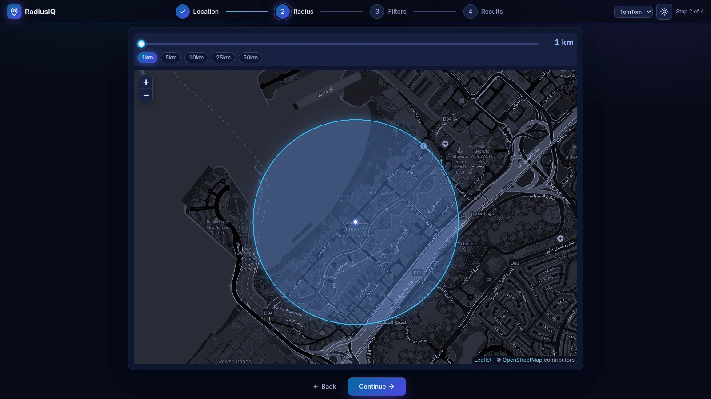

## Screenshots

RadiusIQ has a light theme and a dark "Midnight" theme, and every screen is shown in both below. All screenshots are real captures of the live site at 1600x900, taken during one search for cafes within 1 km of Dubai Marina (TomTom provider). The results are public points of interest returned by the TomTom Search API.

<table>
  <tr>
    <th width="14%"></th>
    <th width="43%">Dark (Midnight)</th>
    <th width="43%">Light</th>
  </tr>
  <tr>
    <td><b>1. Location</b></td>
    <td>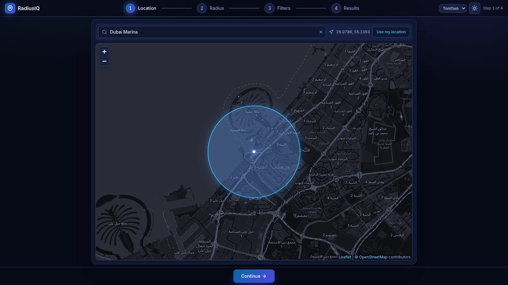</td>
    <td>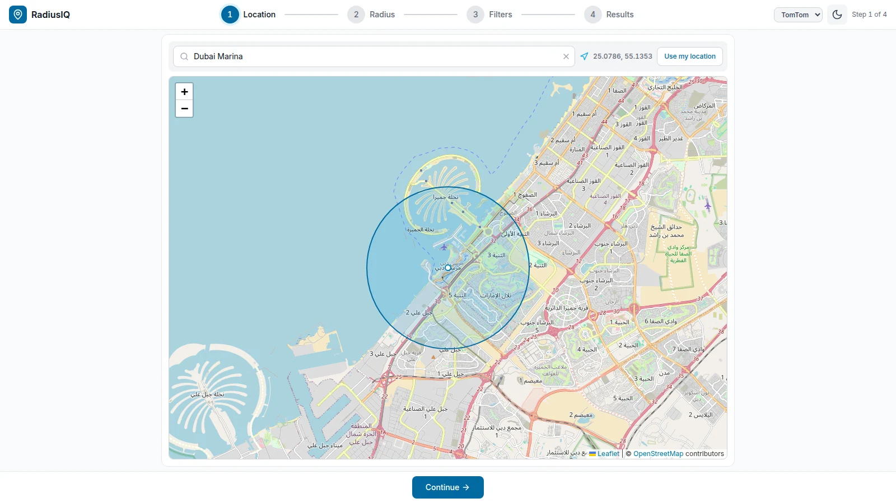</td>
  </tr>
  <tr>
    <td><b>2. Radius</b></td>
    <td align="center">Shown at the top</td>
    <td>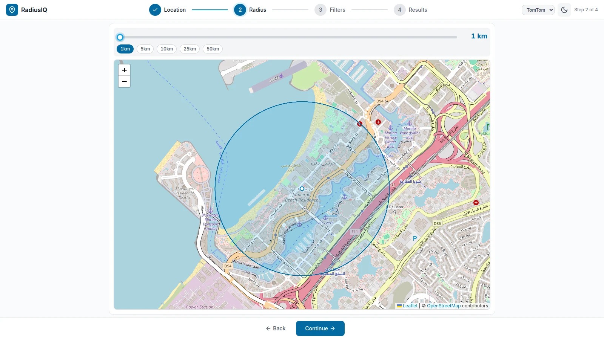</td>
  </tr>
  <tr>
    <td><b>3. Filters</b></td>
    <td>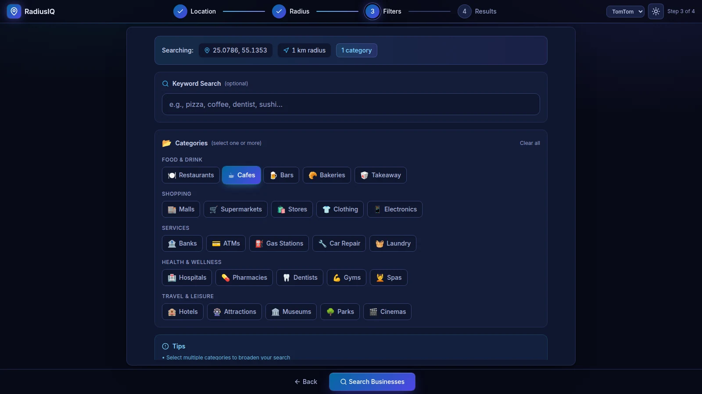</td>
    <td>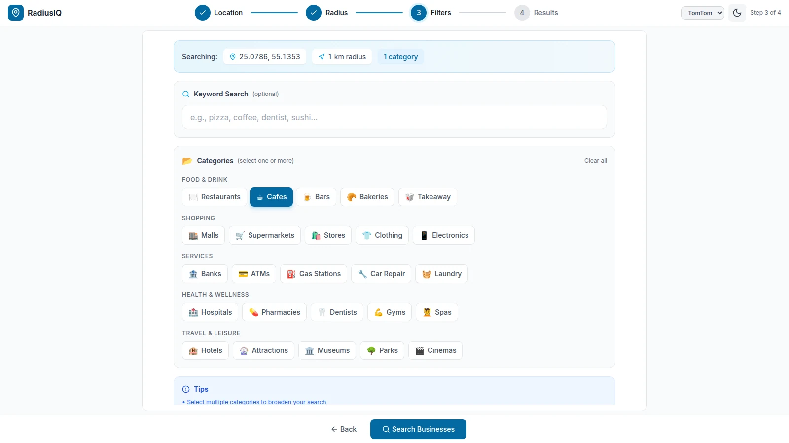</td>
  </tr>
  <tr>
    <td><b>4. Results, grid</b></td>
    <td>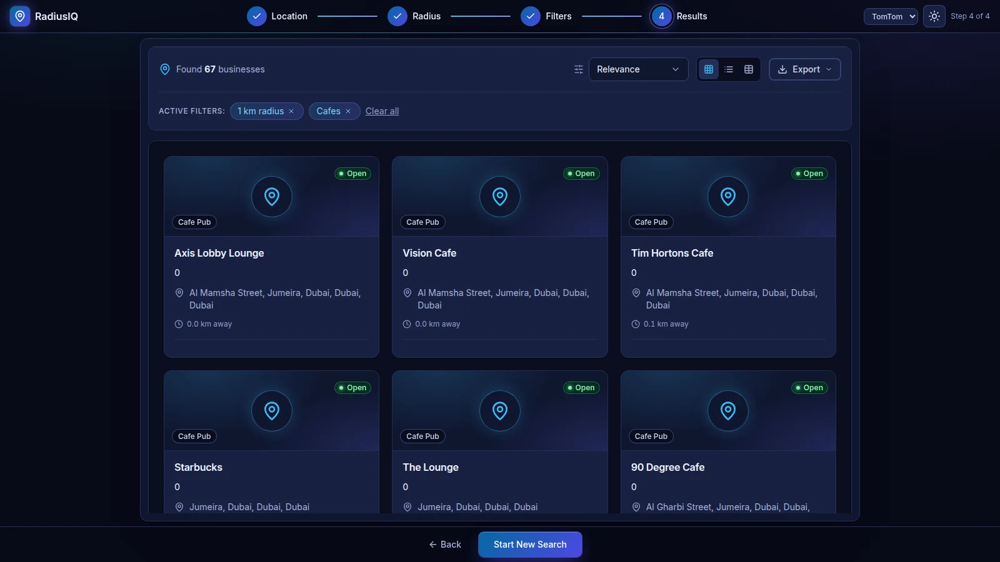</td>
    <td>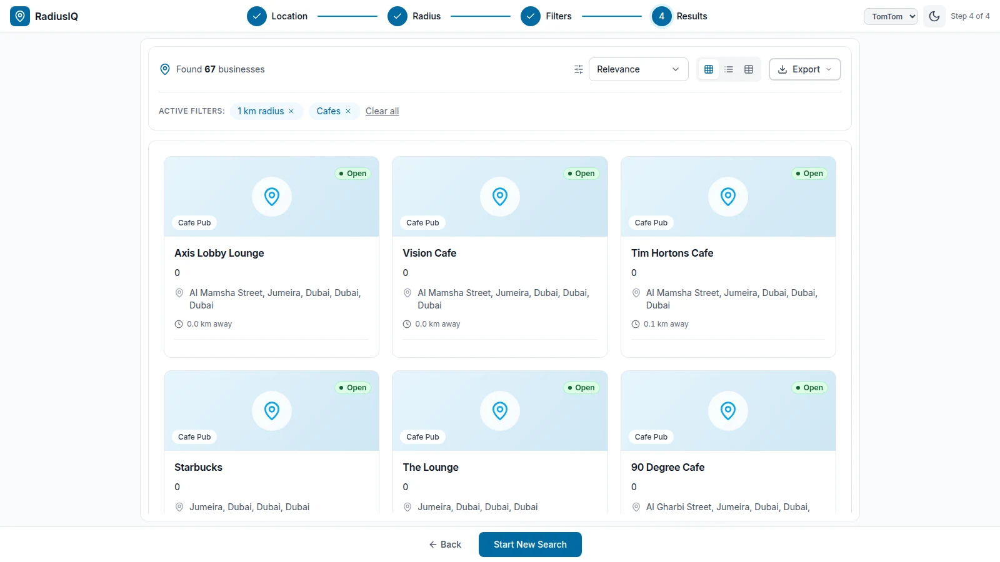</td>
  </tr>
  <tr>
    <td><b>4. Results, table</b></td>
    <td>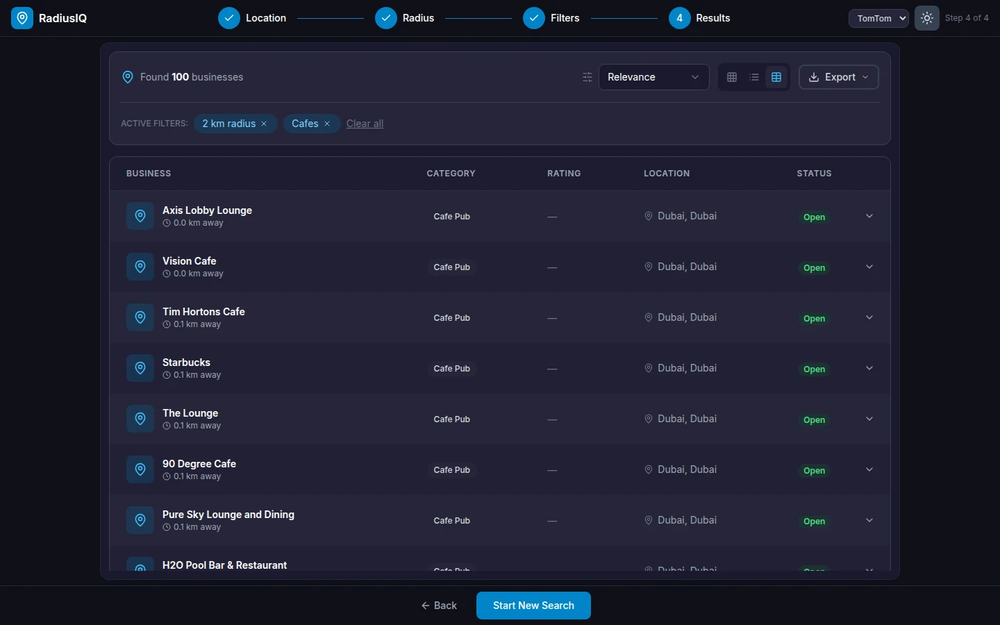</td>
    <td>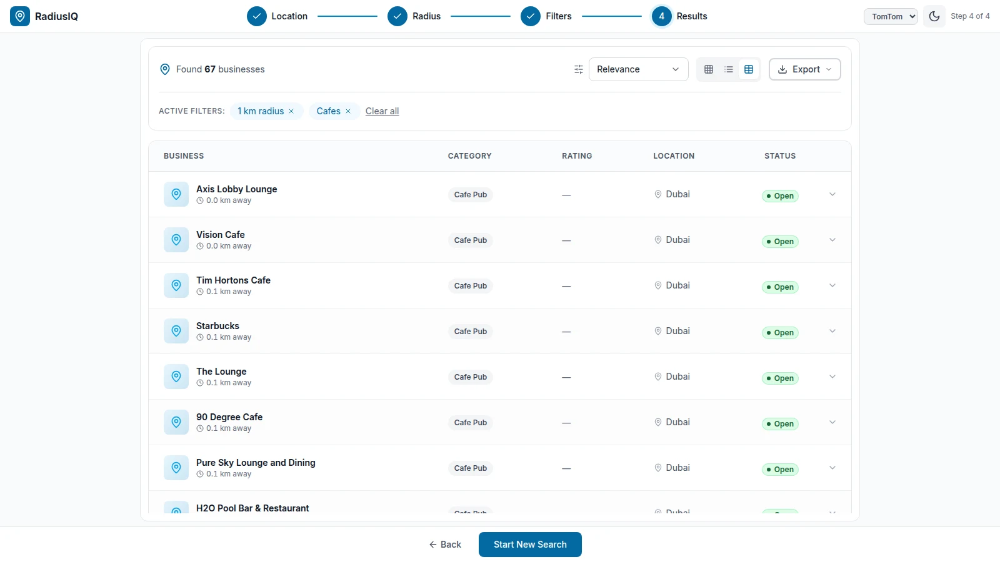</td>
  </tr>
  <tr>
    <td><b>Business detail</b></td>
    <td>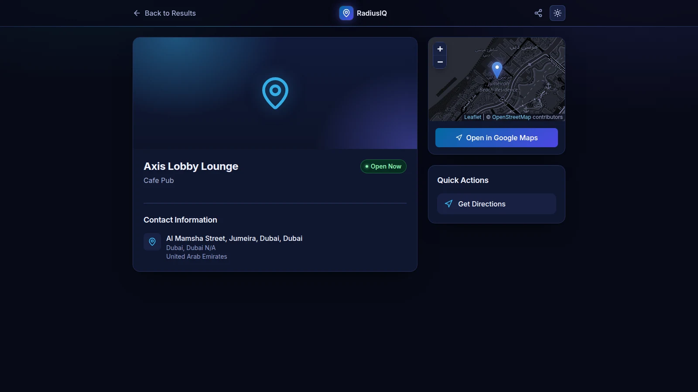</td>
    <td>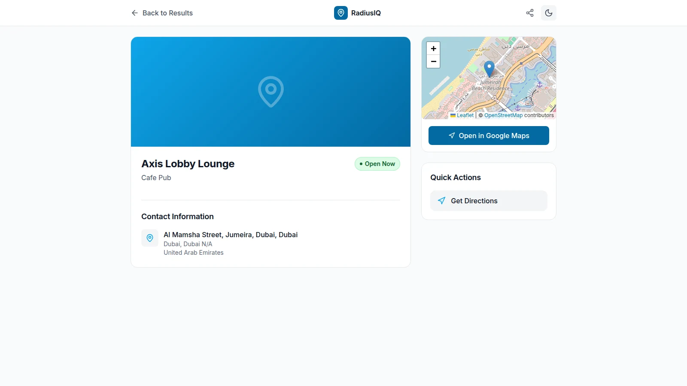</td>
  </tr>
</table>

## Features

**Define the search area**
- Find a starting point by typing an address or place name (debounced OpenStreetMap Nominatim geocoding), by clicking the map, or with the browser's geolocation (**Use my location**).
- Set the radius from 1 to 50 km with a slider or quick presets (1 / 5 / 10 / 25 / 50 km). The circle is drawn live on a Leaflet + OpenStreetMap map, and the map zoom adjusts to the radius.

**Narrow it down**
- 25 categories in 5 groups (Food & Drink, Shopping, Services, Health & Wellness, Travel & Leisure). Each one maps to both a TomTom category code and a Google Places type.
- Optional free-text keyword (e.g. "sushi", "dentist") and multi-select categories.
- A **TomTom / Google** switch in the header picks the data provider for the next search.

**Work with the results**
- Grid, list and table views, active-filter chips you can remove, and "Load more" pagination (TomTom offset paging, Google `next_page_token`).
- Results are ranked nearest-first by straight-line (Haversine) distance from the chosen centre, and each card shows that distance.
- Each business has its own page with its address, a phone number and website when the provider has them, plus opening hours, rating and photo for Google results, a mini map, **Open in Google Maps**, **Get Directions** and Web Share.
- Search state (results, step, location, radius, filters and scroll position) is kept in session storage, so going back from a detail page returns you to the same place in the list.

**Data and API**
- Every result is upserted into PostgreSQL, deduplicated by name and coordinates.
- The API has CSV and XLSX (ExcelJS) export endpoints, filtered and sorted business search, nearby lookup and a category list, all documented with Swagger/OpenAPI.
- Light and dark ("Midnight") themes built on semantic colour tokens. In dark mode the OpenStreetMap tiles are darkened and the radius circle is drawn in a glowing sky-blue accent. The app follows the system preference and has a manual toggle that it remembers.

## Architecture

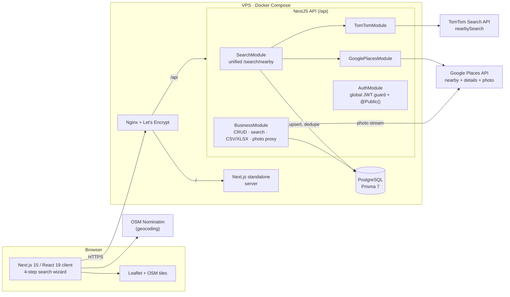

More detail, including the search sequence and the data model, is in [docs/architecture.md](docs/architecture.md).

### Key engineering decisions

- **One endpoint for two providers.** `POST /api/search/nearby` takes a `provider` field. TomTom and Google responses are normalised into a single `Business` shape (category formatting, address assembly, opening hours, URL normalisation), so the frontend renders both the same way.
- **Provider-specific paging and cost.** TomTom returns up to 100 POIs per request with offset paging and needs no detail calls. Google is paged by token and needs a Place Details call per result. TomTom is the default provider, so a typical search costs one upstream request.
- **API keys stay on the server.** The browser never sees a provider key. Google photos are streamed through a server-side photo proxy, and photo URLs are built from a configured public API URL rather than `localhost`.
- **Protected by default.** A global `APP_GUARD` applies JWT auth to every route, and only the endpoints the guest search flow needs opt out with a `@Public()` decorator.
- **Results are stored, not thrown away.** Each result is upserted on name + coordinates, so repeated searches update existing rows instead of creating duplicates. The stored data then backs export and filtered search.
- **Small production containers.** Multi-stage `node:22-alpine` images run as non-root users (Next.js `output: 'standalone'`), with health checks and memory limits. A GitHub Actions pipeline builds both images and runs the backend test step against a throwaway Postgres service. On `main` it deploys over SSH, runs `prisma migrate deploy` and rolls back to the previous commit if the health checks fail.

## Tech stack

| Layer | Tech |
|---|---|
| Frontend | Next.js 15 (App Router), React 19, TypeScript, Tailwind CSS, Zustand (persisted auth state), Axios, Lucide icons |
| Maps & geocoding | Leaflet / react-leaflet, OpenStreetMap tiles, OSM Nominatim |
| Backend | NestJS 10, class-validator DTOs, Passport JWT, bcrypt, Swagger / OpenAPI, ExcelJS |
| Data providers | TomTom Search API (nearby search), Google Places API (nearby search, place details, photos) |
| Database | PostgreSQL with Prisma 7 (`@prisma/adapter-pg`) |
| Infrastructure | Docker Compose, Nginx reverse proxy, Let's Encrypt TLS, VPS |
| CI/CD | GitHub Actions (Docker build, test step, SSH deploy with health-check rollback), Claude Code review workflow on PRs |

## My role

This is my personal project, and I am its only developer. I designed and built all of it:

- Product and UX: the 4-step wizard, the category taxonomy mapped to both providers, and the result views and detail page.
- Frontend: Next.js app, Leaflet map and radius tooling, geocoding, theming, and keeping search state across navigation.
- Backend: NestJS module structure, TomTom and Google Places integrations, normalisation and deduplication, export, auth and Swagger docs.
- DevOps: multi-stage Dockerfiles, Compose stack, the Nginx/TLS setup and the CI/CD pipeline with automatic rollback.

I used AI coding agents as part of the workflow (several feature branches were produced with an agent pipeline and reviewed and merged by me, and a Claude Code review action runs on pull requests). Commits made by those agents and by my server account are part of my own repository history.

## Status

- **Live:** [radius.everbuild.cloud](https://radius.everbuild.cloud). Searching works without an account.
- **Timeline:** built between January and February 2026 (git history from 24 Jan to 4 Feb 2026), with maintenance since then (base image moved to `node:22-alpine` in October 2026, and the light and dark themes reworked in November 2026).
- **Next:** connect the results toolbar's Export menu and sort control to the existing API endpoints (the export and sorted-search endpoints exist, but the toolbar controls don't call them yet), and add saved searches and history for signed-in users (the data model and search-history endpoints already exist).

---

© 2026 Dafallah Ibrahim. Screenshots and documentation only. Source code is private.

