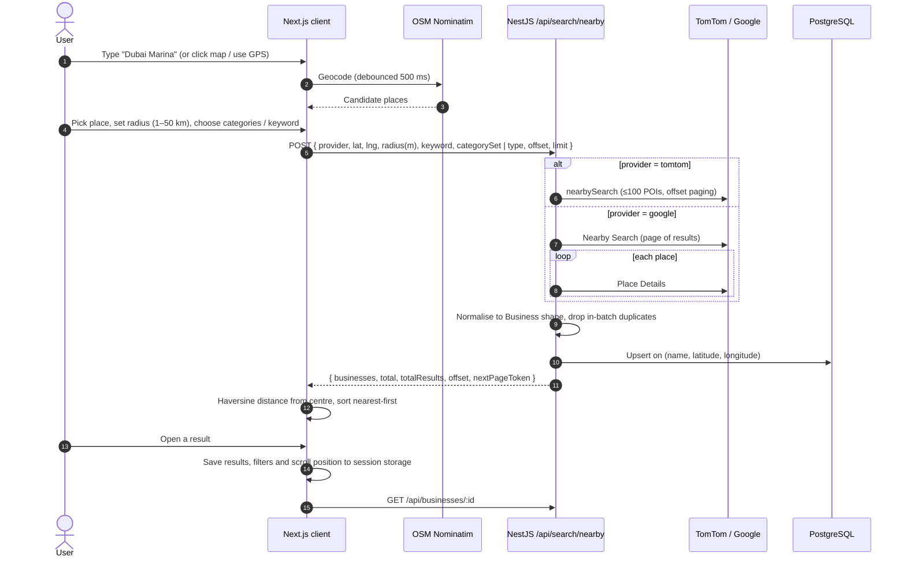
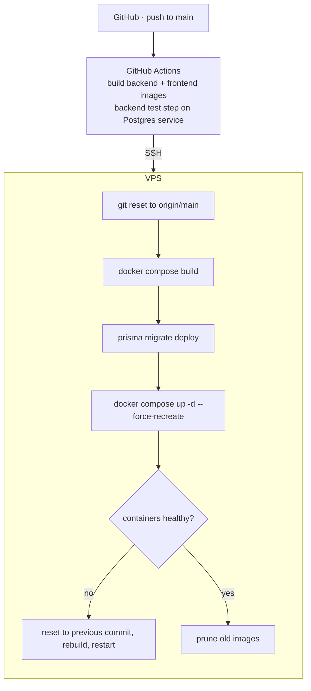

# RadiusIQ architecture

RadiusIQ (formerly Radius Crawler) is a TypeScript monorepo with two deployable apps: a Next.js 15 frontend and a NestJS 10 API. Both run in Docker Compose behind Nginx on a single VPS, and they share a PostgreSQL instance with other services on that host.

## Components

| Component | Responsibility |
|---|---|
| **Next.js client** (`/`) | The 4-step wizard (Location → Radius → Filters → Results), Leaflet map with radius circle, Nominatim geocoding, result views (grid / list / table), business detail page, theme handling. State lives in React state and Zustand; search state is copied to session storage before navigating to a detail page. |
| **NestJS API** (`/api`) | Feature modules: `search`, `tomtom`, `google-places`, `business`, `auth`, plus `core` (config, Prisma, health) and `common` (global guard, exception filter, response interceptor, `@Public()` decorator). Global `ValidationPipe` with whitelisting; Swagger docs generated from DTOs. |
| **TomTomModule** | Wraps the TomTom Search `nearbySearch` endpoint (lat, lon, radius, optional keyword in the path, optional `categorySet`, `limit` up to 100, `ofs` offset). Turns 400/403/429 responses into clear API errors. |
| **GooglePlacesModule** | Wraps the Places Nearby Search and Place Details endpoints. Results are paged with `next_page_token`. |
| **BusinessModule** | Business CRUD, filtered/sorted search, nearby lookup, category list, CSV and XLSX (ExcelJS) export, and a streaming photo proxy for Google photo references. |
| **AuthModule** | Register/login with bcrypt-hashed passwords and Passport JWT. A global `APP_GUARD` protects every route unless it is marked `@Public()`. |
| **PostgreSQL + Prisma 7** | `users`, `businesses`, `searches` (history) and `saved_searches`. Businesses are indexed on category, city/state, lat/lng and rating. Prisma 7 runs on the `pg` driver adapter. |

## Search flow

## Provider normalisation

The two providers return very different payloads. The search service maps both into one record:

- **Category:** the TomTom classification code or the highest-priority Google type (restaurant, cafe, bar, store, and so on), turned into a readable label.
- **Address:** TomTom's `freeformAddress`, or one rebuilt from its parts. For Google, the formatted address plus address components (locality, admin area, postal code, country).
- **Contact and extras:** phone, website (URLs without a scheme are normalised), and opening hours (TomTom time ranges or Google weekday text). Google results also carry rating, review count, price level and a proxied photo URL.

The frontend keeps a single category list in which each entry has both a TomTom category id and a Google Places type, so the same filter UI works with either provider.

## Deployment

- **Images:** multi-stage `node:22-alpine` builds. Prisma client is generated at build time, the Next.js output is `standalone`, and the containers run as non-root users (`nestjs`, `nextjs`).
- **Runtime:** containers listen only on the host loopback. Nginx terminates TLS (Let's Encrypt), proxies `/` to the frontend and `/api` to the backend. Each service has a `wget` health check and memory limits. The backend joins an external Docker network to reach the shared Postgres.
- **Config:** `NEXT_PUBLIC_*` values are passed to the frontend as build args. Provider keys and the JWT secret exist only in the backend's environment.
- **Provisioned for later:** the Compose stack includes a Redis service with an LRU memory cap. The API does not use it yet; it is reserved for response caching.
